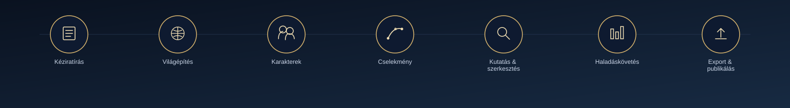
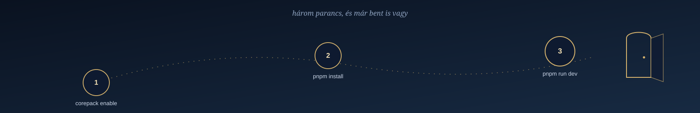
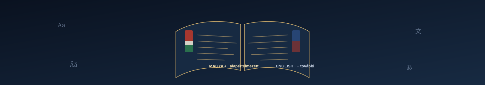
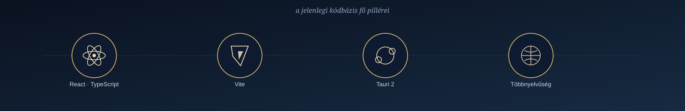
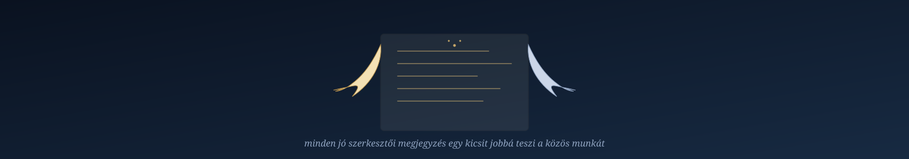
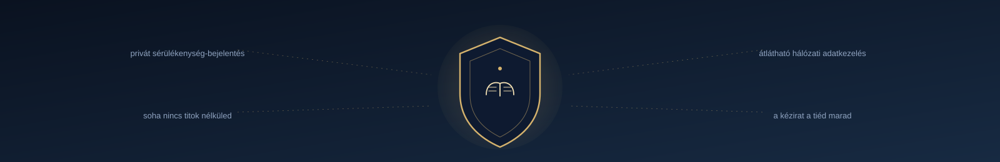
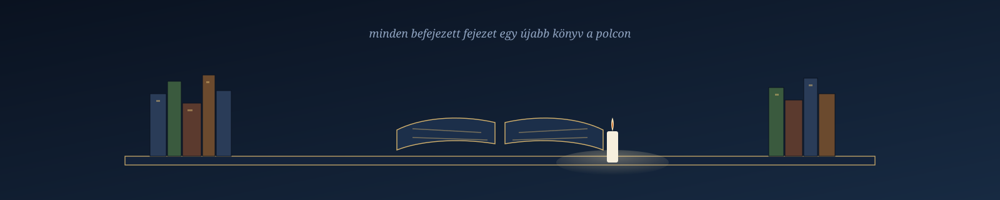

<p align="center">
  
</p>

<p align="center">
  <a href="https://github.com/diablomike20/Andersen"></a>
  
  
  
</p>

<p align="center">
  <em>Your world. Your story. Your creation.</em>
</p>

<p align="center">
  <a href="#a-történet-műhelye">Kézirat</a> ·
  <a href="#építs-fel-egy-saját-univerzumot">Világ</a> ·
  <a href="#akik-életre-keltik-a-történetet">Karakterek</a> ·
  <a href="#a-cselekmény-mögötti-szerkezet">Cselekmény</a> ·
  <a href="#egy-alkotói-tér-egy-teljes-ökoszisztéma">Ökoszisztéma</a> ·
  <a href="#alkotói-szabadság-tudatos-alapok">Alapelvek</a> ·
  <a href="#első-lépések">Első lépések</a>
</p>

<p align="center">
  
</p>

<p align="center">
  
</p>

> *Kedves Olvasó,*
>
> ez nem egy újabb szövegszerkesztő szeretne lenni. Azoknak épül, akik éjszakákat öltek már egy mondatba, mert az első tíz változat még nem volt elég jó. Akik egy kitalált város utcáit jobban ismerik, mint a sajátjukét. Akiknek a könyvespolc nem bútor, hanem térkép – arról, hogy kik voltak és kik szeretnének lenni.
>
> Mi magunk is ilyenek vagyunk. Ezért épül az Andersen úgy, ahogy egy jó könyvet olvasunk: lassan, figyelmesen, és azzal a tisztelettel, amit egy történet megérdemel – akár a tiéd, akár azé, akinek írod.
>
> *— az Andersen csapata*

<p align="center">
  
</p>


Minden nagy történet egyetlen gondolattal kezdődik. Egy karakterrel. Egy hellyel. Egy lehetetlennel, ami egyszer csak valósággá válik. Aztán jön az éjszaka, amikor leülsz, és megpróbálod papírra – vagy képernyőre – vetni azt, amit magad előtt látsz.

<br clear="left">

**Az Andersen nem egy funkciólista. Egy műhely** – íróknak, történetmesélőknek és világépítőknek, akik elhiszik, hogy egy jól megépített világ ugyanúgy megérdemli a gondosságot, mint maga a mondat, amit éppen csiszolsz. Egy helyen tartja a kéziratot, a karaktereket, a világot, a cselekményt, a kutatást és a szerkesztést, hogy ne az eszközeiddel kelljen bajlódnod – hanem azzal, amiért tulajdonképpen leültél: a történettel.

**A történet a tiéd. Az irányítás is.**

<p align="center">
  
</p>

<p align="center">
  <sub>ÖTLET → FELFEDEZÉS → ÉPÍTÉS → FINOMÍTÁS → MEGOSZTÁS</sub>
</p>

<p align="center">
  
</p>

## A történet műhelye

<p align="center">
  
</p>


Egy kézirat sosem csak szöveg. Fejezetek, jelenetek, arcok, helyszínek és félig elfelejtett jegyzetek fonódnak össze benne, gyakran úgy, hogy te magad sem veszed észre, melyik mikor került bele. Az Andersen azért épül úgy, hogy ez az összefonódás természetes maradjon – a fejezetek között ugyanúgy lehet lapozni, mint egy valódi könyvben –, miközben minden alkotói döntés végig a te kezedben marad.

<br clear="left">

<p align="center">
  
</p>

## Építs fel egy saját univerzumot

<p align="center">
  
</p>


Egy hiteles világ ritkán a részletek mennyiségéről szól – inkább arról, hogy összeérnek-e. Helyszínek, kultúrák, törvények, régi történelem és apró, szinte észrevehetetlen momentumok, amelyek valahogy mégis mind egymásra mutatnak. Ezekből áll össze az, amit az olvasó talán sosem lát tisztán kimondva, mégis érez: hogy a világ, amiben éppen jár, élő. Az Andersen világépítő eszközei ennek a láthatatlan rendnek adnak otthont.

<br clear="left">

<p align="center">
  
</p>

## Akik életre keltik a történetet

<p align="center">
  
</p>


Egy karakter nem egy név egy listában. Vágyak, sebek, apró ellentmondások és azok a pillanatok formálják, amikor valaki egészen mást választ, mint amit a történet – vagy éppen te magad – várt volna tőle. Az Andersen karakterkezelő tere ezért nem adatlapokban gondolkodik, hanem kapcsolatokban: abban a láthatatlan hálóban, ami egyben tartja a szereplőidet, legyenek emberi vagy éppen egészen nem emberi lények.

<br clear="left">

<p align="center">
  
</p>

## A cselekmény mögötti szerkezet

<p align="center">
  
</p>


Egy jó történet ritmusa ritkán a véletlen műve. Fordulópontok, visszatartott információk, és jelenetek, amelyek csendben készítik elő a következő ütést – ezek adják azt a sodrást, amitől az olvasó nem tud letenni egy könyvet. Az Andersen segít megtervezni a nagy ívet, aztán jelenetről jelenetre bontani, hogy sose veszítsd szem elől, hogyan kapcsolódik össze minden egyetlen egésszé.

<br clear="left">

<p align="center">
  
</p>

## Egy alkotói tér. Egy teljes ökoszisztéma.

<p align="center">
  
</p>

<p align="center">
  
</p>


Hét terület, egyetlen közös nyelven – mindegyik a maga helyén, mégis ugyanannak a történetnek a részeként:

<br clear="left">

<p align="center">
  
</p>

| Alkotói terület | Mire használhatod? |
|---|---|
| **Kéziratírás** | Fejezetekre és részekre tagolt kézirat, dedikált írófelületen |
| **Világépítés** | Szereplők, helyszínek, háttérinformációk és világszabályok rendszerezése |
| **Karakterek és kapcsolatok** | Motivációk, szereplői ívek és kapcsolatrendszerek |
| **Cselekménytervezés** | Történetvázlatok, cselekményszerkezetek, gondolattérképek és idővonalak |
| **Kutatás és szerkesztés** | Háttéranyagok kezelése és a szöveg finomítása a projekten belül |
| **Haladáskövetés** | Alkotói célok és a projekt állapotának követése |
| **Exportálás és publikálás** | A munka előkészítése a támogatott exportfolyamatokhoz |

*Az egyes funkciók elérhetősége platformonként és beállításonként eltérhet. A hálózati szolgáltatások internetkapcsolatot igényelnek.*

<p align="center">
  
</p>

## Alkotói szabadság. Tudatos alapok.

<p align="center">
  
</p>


### Az alkotóé az utolsó szó

A kézirat a tiéd, és minden adat, ami körülötte születik, szintén. Amit a mesterséges intelligencia hozzátesz, az javaslat – egy ötlet, amit elfogadhatsz, átírhatsz vagy nyugodtan figyelmen kívül hagyhatsz. Sosem tekintély, és sosem írja felül észrevétlenül azt, amit te eldöntöttél a saját történetedről.

<br clear="left">


### Helyi működés, átlátható adatkezelés

A mindennapi munka – az írás, a szerkesztés, a világod építése – alapesetben helyben, a te gépeden történik. Néhány választható funkció, mint a felhőalapú MI-szolgáltatók, az együttműködési szolgáltatások, a nyelvi ellenőrzők vagy a frissítés-ellenőrzések, hálózati kapcsolatot igényel. Ezeket csak akkor kapcsold be, ha pontosan tudod, mit vállalsz velük.

<br clear="left">


### MI, amikor szeretnéd. Szabadság, mindig.

Az Andersen API-kulcs nélkül, szolgáltató nélkül – sőt, teljesen MI nélkül is – az marad, aminek készült: egy hely, ahol írni lehet. Ha szeretnéd, dolgozhatsz támogatott felhőalapú, helyi vagy böngészőben futó modellekkel is. De a mesterséges intelligencia nálunk sosem főszereplő, legfeljebb egy csendes társ, aki csak akkor szólal meg, ha hívod.

<br clear="left">


### Nyílt fejlesztés, valódi közreműködés

Szeretnénk, ha az Andersen működése megismerhető maradna, a kódja továbbgondolható, a közösség hangja pedig valóban számítana. Inkább mutatjuk meg pontosan, hol tart most a projekt – mi kész, mi még kísérleti, mi hiányzik –, mint hogy hangzatos ígéretekkel fedjük el.

<br clear="left">

<p align="center">
  
</p>

## A te munkakörnyezeted

<p align="center">
  
</p>


Írhatsz böngészőben, telepítheted PWA-ként a gépedre, vagy használhatod natív asztali alkalmazásként, Tauri alapokon. Bárhol is írsz éppen, a kézirat és a hangod ugyanaz marad. A pontos platformtámogatás és az egyes funkciók elérhetősége kiadásonként eltérhet.

<br clear="left">

<p align="center">
  
</p>

## Első lépések

<p align="center">
  
</p>

### Az alkalmazás használata

Ez a repository az Andersen forráskódját és fejlesztési anyagait tartalmazza. A kiadott, futtatható webes változatok és telepítők a projekt GitHub Releases oldalán jelennek meg, amint közzétételre kerülnek.

### Futtatás forráskódból

Ha szívesebben néznél be a motorháztető alá, mielőtt bárki más kipróbálná: a projekt Node.js-t és pnpm-et használ. A pontos verziókat és parancsokat indulás előtt ellenőrizd a `package.json` fájlban.

```bash
corepack enable
pnpm install
pnpm run dev
```

Éles webes build készítése:

```bash
pnpm run build
```

Asztali fejlesztői környezet indítása:

```bash
pnpm run tauri:dev
```

Egyes natív célplatformokhoz a Tauri platformfüggő fejlesztői eszközei is szükségesek. A fenti parancsok a forráskód futtatásához adnak kiindulópontot; nem garantálják, hogy minden célplatform külön konfiguráció nélkül buildelhető.

<p align="center">
  
</p>

## Nyelvek

<p align="center">
  
</p>

- Alapértelmezett kezelőfelületi nyelv: **magyar**
- Az angol és további fordítások is részei a projektnek.
- A fordítási kulcsok teljessége önmagában nem garantálja a szakmailag és nyelvileg kifogástalan szöveget. Szívesen fogadunk javaslatokat a terminológia, az egységesség és a nyelvi minőség javítására.

<p align="center">
  
</p>

## Technológiai háttér

<p align="center">
  
</p>

A jelenlegi kódbázis főbb technológiái:

- React és TypeScript
- Vite
- Tauri 2 az asztali alkalmazáshoz
- Moduláris többnyelvűségi rendszer
- Választható MI-szolgáltatói és helyi modellintegrációk

A pontos függőségverziókat és az elérhető parancsokat a `package.json` tartalmazza.

<p align="center">
  
</p>

## Közreműködés

<p align="center">
  
</p>

Az Andersen nyílt projekt: örömmel fogadjuk az ötleteket, hibajelentéseket és a közösség érdemi hozzájárulását – akárcsak egy jó szerkesztői megjegyzést egy kéziraton.

Pull request beküldése előtt:

1. Olvasd el a repository közreműködési és biztonsági útmutatóját.
2. Írd le, milyen problémát old meg a módosítás, és hogyan segíti a felhasználókat.
3. Tartsd a változtatásokat célzottan, kerüld a témához nem kapcsolódó átalakításokat.
4. Viselkedésváltozás esetén egészítsd ki vagy frissítsd a teszteket.
5. Soha ne tölts fel API-kulcsokat, hitelesítő adatokat, személyes kéziratokat vagy más bizalmas adatokat.
6. Jelezd egyértelműen, ha egy funkció kísérleti, platformfüggő vagy külső szolgáltatástól függ.

Nagyobb változtatás előtt nyiss egy issue-t, hogy egyeztethessük az irányt.

<p align="center">
  
</p>

## Biztonság és adatvédelem

<p align="center">
  
</p>

Biztonsági sérülékenységet ne nyilvános issue-ban jelents. Használd a repository privát sérülékenység-bejelentési lehetőségét, amikor elérhető. Hibajelentésben soha ne szerepeljen valódi API-kulcs, token, személyes adat vagy bizalmas kéziratrészlet.

Az Andersen nem tünteti el a hálózati adatforgalmat: ha felhőszolgáltatót vagy online integrációt választasz, az adott szolgáltatás működéséhez szükséges információ elhagyhatja az eszközödet. Az integráció használata előtt ismerd meg a szolgáltató adatvédelmi feltételeit és a projekt biztonsági dokumentációját.

## Licenc

A projekt megtartja a forráskódban szereplő licencet. A teljes feltételeket a [LICENSE](LICENSE) fájl tartalmazza.

---

<p align="center">
  
</p>

<p align="center">
  <strong>ANDERSEN</strong><br>
  <em>Give your imagination a universe.</em><br>
  <sub>Adj teret a történetnek.</sub>
</p>

<p align="center">
  <sub>A README-ben szereplő grafikai illusztrációk önállóan, az Andersen márkához készültek. Koncepcionális bemutatóképek, nem az alkalmazás képernyőképei.</sub>
</p>
