<p align="center">
  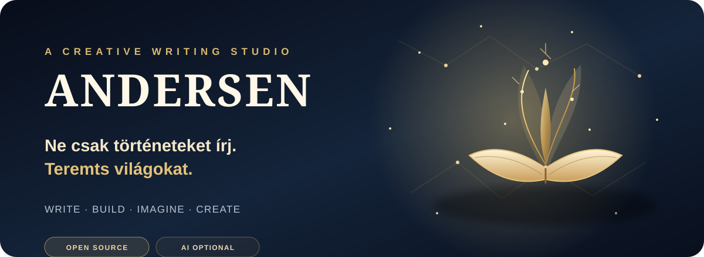
</p>

<p align="center">
  <a href="https://github.com/diablomike20/Andersen"></a>
  
  
  
</p>

<p align="center">
  <em>Your world. Your story. Your creation.</em>
</p>

<p align="center">
  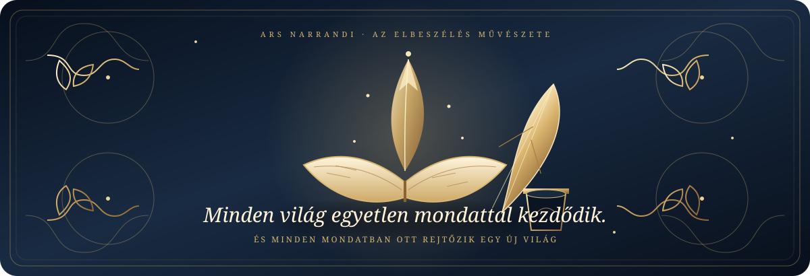
</p>

---

Minden nagy történet egyetlen gondolattal kezdődik. Egy karakterrel. Egy hellyel. Egy lehetetlennel, ami egyszer csak valósággá válik.

**Az Andersen egy nyílt forráskódú kreatív alkotóműhely íróknak, történetmesélőknek és világépítőknek.** Egyetlen összefüggő munkakörnyezetben kapcsolja össze a kéziratírást, a karakteralkotást, a világépítést, a cselekménytervezést, a kutatást és a szerkesztést – hogy ne a szétszórt eszközökkel, hanem az alkotással foglalkozhass.

**A történet a tiéd. Az irányítás is.**

<p align="center">
  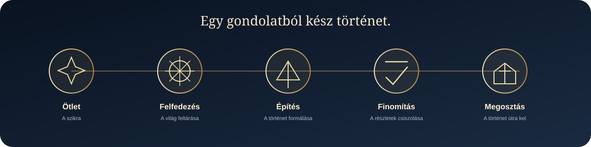
</p>

<p align="center">
  <sub>ÖTLET → FELFEDEZÉS → ÉPÍTÉS → FINOMÍTÁS → MEGOSZTÁS</sub>
</p>

<p align="center">
  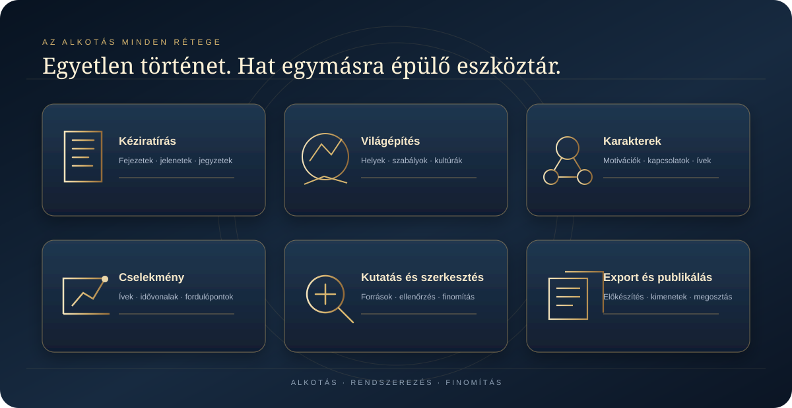
</p>

<p align="center"></p>

## A történet műhelye

<p align="center">
  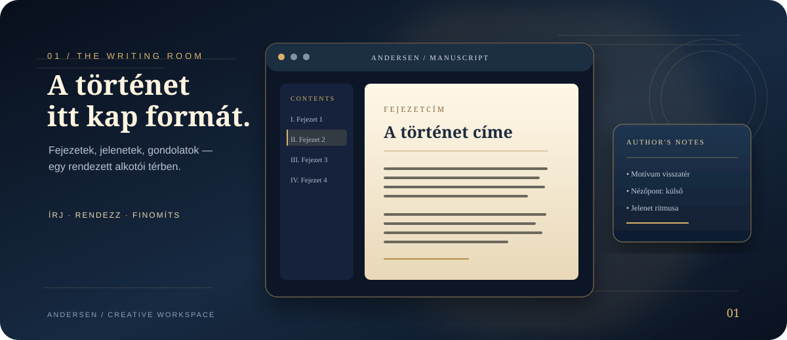
</p>

A kézirat nem elszigetelt dokumentum. A fejezetek, jelenetek, karakterek, helyszínek és jegyzetek ugyanahhoz a történethez tartoznak. Az Andersen célja, hogy ezek között természetes legyen az átjárás, miközben az alkotói döntés végig nálad marad.

<p align="center"></p>

## Építs fel egy saját univerzumot

<p align="center">
  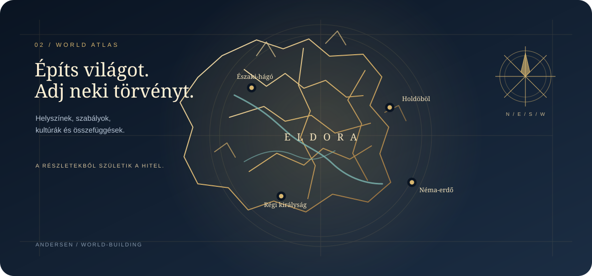
</p>

A hiteles történet mögött következetes világ áll. Helyszínek, kultúrák, szabályok, történelmi rétegek és apró részletek, amelyek egymással összefüggnek. Az Andersen világépítő eszközei segítenek rendszerezni mindazt, amit az olvasó talán soha nem lát közvetlenül – de amitől a világ élőnek hat.

<p align="center"></p>

## Akik életre keltik a történetet

<p align="center">
  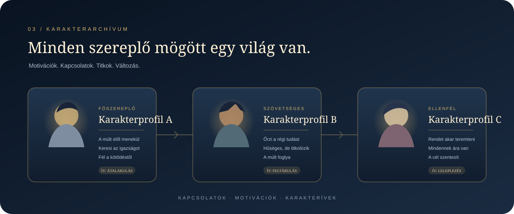
</p>

A szereplők többek egyszerű neveknél. Motivációk, célok, konfliktusok, kapcsolatok és változások formálják őket. Az Andersen karakter- és kapcsolatkezelési területe segít egyben látni a történet emberi – vagy éppen nem emberi – hálózatát.

<p align="center"></p>

## A cselekmény mögötti szerkezet

<p align="center">
  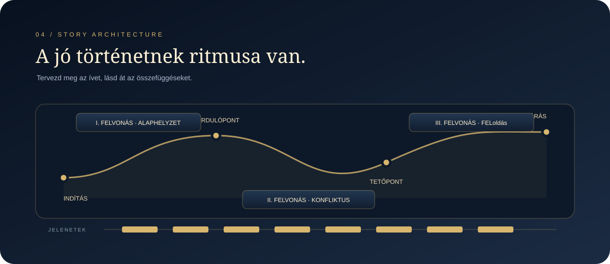
</p>

A történet ritmusát a fordulópontok, a jelenetek és az egymásra épülő események adják. Tervezd meg a nagy ívet, bontsd részekre a cselekményt, és tartsd szem előtt, hogyan kapcsolódnak össze a részletek.

<p align="center"></p>

## Egy alkotói tér. Egy teljes ökoszisztéma.

<p align="center">
  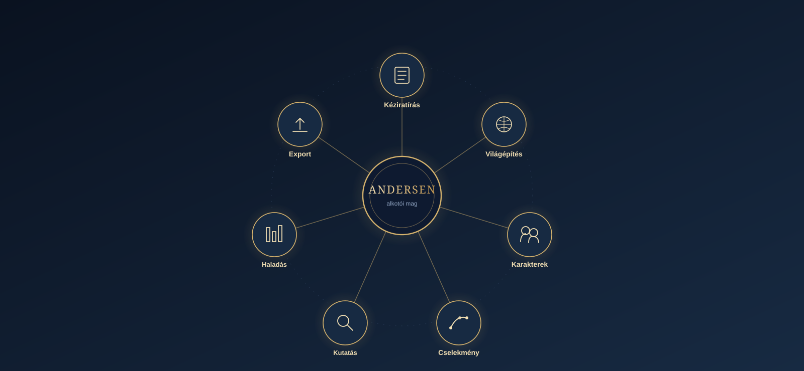
</p>

<p align="center">
  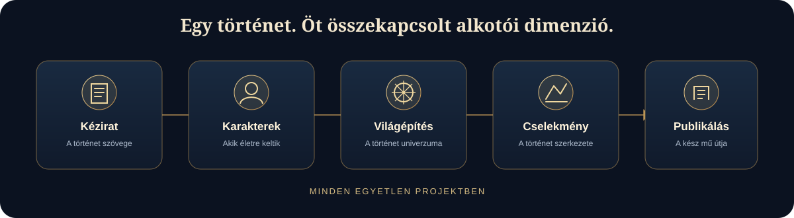
</p>

| Alkotói terület | Mire használhatod? |
|---|---|
| **Kéziratírás** | Fejezetekre és részekre tagolt kézirat, dedikált írófelületen |
| **Világépítés** | Szereplők, helyszínek, háttérinformációk és világszabályok rendszerezése |
| **Karakterek és kapcsolatok** | Motivációk, szereplői ívek és kapcsolatrendszerek |
| **Cselekménytervezés** | Történetvázlatok, cselekményszerkezetek, gondolattérképek és idővonalak |
| **Kutatás és szerkesztés** | Háttéranyagok kezelése és a szöveg finomítása a projekten belül |
| **Haladáskövetés** | Alkotói célok és a projekt állapotának követése |
| **Exportálás és publikálás** | A munka előkészítése a támogatott exportfolyamatokhoz |

Az egyes funkciók elérhetősége platformonként és beállításonként eltérhet. A hálózati szolgáltatások internetkapcsolatot igényelnek.

<p align="center"></p>

## Alkotói szabadság. Tudatos alapok.

<p align="center">
  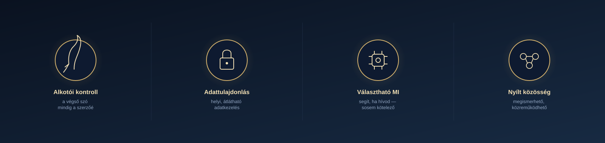
</p>

<p align="center">
  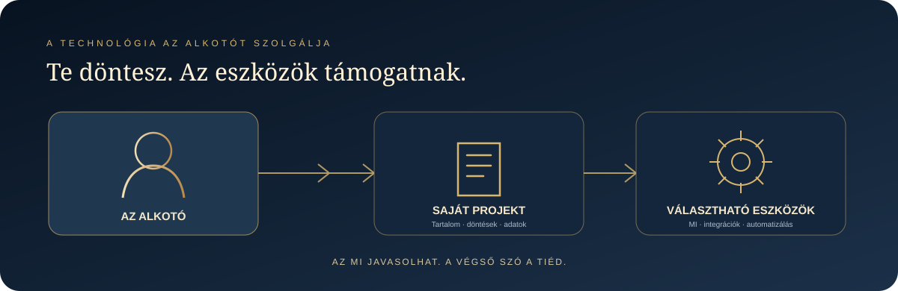
</p>

### Az alkotóé az utolsó szó

A kézirat és a projekt adatai jelentik a munka alapját. Az MI által készített tartalom javaslat, nem pedig olyan tekintély, amely észrevétlenül felülírhatja a szerző munkáját.

### Helyi működés, átlátható adatkezelés

Az alapvető projektmunkafolyamatok a helyi adattulajdonlásra épülnek. Bizonyos választható funkciók – például a felhőalapú MI-szolgáltatók, az együttműködési szolgáltatások, a nyelvi ellenőrzők, a modellletöltések és a frissítés-ellenőrzések – hálózati kapcsolatot használnak. Minden integrációt csak a működésének megismerése után engedélyezz.

### MI, amikor szeretnéd. Szabadság, mindig.

Az Andersen akkor is használható írói környezet marad, ha nincs beállított API-kulcsod, nem érhető el egyetlen szolgáltató sem, vagy egyszerűen kikapcsolod az MI-funkciókat.

A támogatott szolgáltatókkal, helyi vagy böngészőben futó modellekkel is dolgozhatsz – de az MI nem kötelező főszereplő.

### Nyílt fejlesztés, valódi közreműködés

A projekt célja, hogy a működése megismerhető, továbbfejleszthető és a közreműködők számára is hozzáférhető legyen. A pontos dokumentáció, az ellenőrizhető tesztek és a funkciók érettségének őszinte bemutatása fontosabb a hangzatos ígéreteknél.

<p align="center"></p>

## A te munkakörnyezeted

<p align="center">
  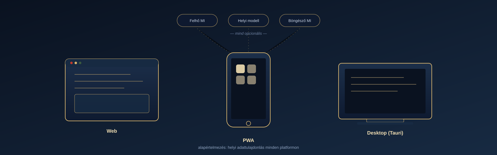
</p>

Az Andersen webes környezetben, telepíthető PWA-ként és Tauri-alapú asztali alkalmazásként is fejlesztett projekt. A pontos platformtámogatás és az egyes funkciók elérhetősége kiadásonként eltérhet.

<p align="center">
  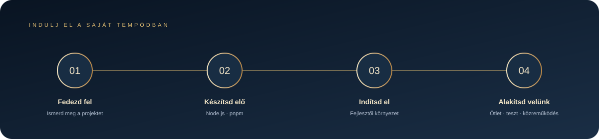
</p>

<p align="center"></p>

## Első lépések

### Az alkalmazás használata

Ez a repository az Andersen forráskódját és fejlesztési anyagait tartalmazza. A kiadott, futtatható webes változatok és telepítők a projekt GitHub Releases oldalán jelennek meg, amint közzétételre kerülnek.

### Futtatás forráskódból

A projekt Node.js-t és pnpm-et használ. A pontos verziókat és parancsokat indulás előtt ellenőrizd a `package.json` fájlban.

```bash
corepack enable
pnpm install
pnpm run dev
```

Éles webes build készítése:

```bash
pnpm run build
```

Asztali fejlesztői környezet indítása:

```bash
pnpm run tauri:dev
```

Egyes natív célplatformokhoz a Tauri platformfüggő fejlesztői eszközei is szükségesek. A fenti parancsok a forráskód futtatásához adnak kiindulópontot; nem garantálják, hogy minden célplatform külön konfiguráció nélkül buildelhető.

## Nyelvek

- Alapértelmezett kezelőfelületi nyelv: **magyar**
- Az angol és további fordítások is részei a projektnek.
- A fordítási kulcsok teljessége önmagában nem garantálja a szakmailag és nyelvileg kifogástalan szöveget. Szívesen fogadunk javaslatokat a terminológia, az egységesség és a nyelvi minőség javítására.

## Technológiai háttér

A jelenlegi kódbázis főbb technológiái:

- React és TypeScript
- Vite
- Tauri 2 az asztali alkalmazáshoz
- Moduláris többnyelvűségi rendszer
- Választható MI-szolgáltatói és helyi modellintegrációk

A pontos függőségverziókat és az elérhető parancsokat a `package.json` tartalmazza.

<p align="center">
  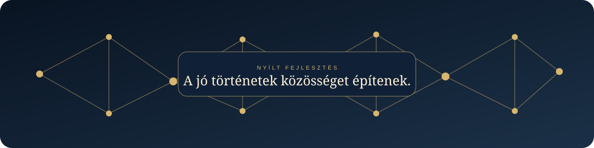
</p>

<p align="center"></p>

## Közreműködés

Az Andersen nyílt projekt: örömmel fogadjuk az ötleteket, hibajelentéseket és a közösség érdemi hozzájárulását.

Pull request beküldése előtt:

1. Olvasd el a repository közreműködési és biztonsági útmutatóját.
2. Írd le, milyen problémát old meg a módosítás, és hogyan segíti a felhasználókat.
3. Tartsd a változtatásokat célzottan, kerüld a témához nem kapcsolódó átalakításokat.
4. Viselkedésváltozás esetén egészítsd ki vagy frissítsd a teszteket.
5. Soha ne tölts fel API-kulcsokat, hitelesítő adatokat, személyes kéziratokat vagy más bizalmas adatokat.
6. Jelezd egyértelműen, ha egy funkció kísérleti, platformfüggő vagy külső szolgáltatástól függ.

Nagyobb változtatás előtt nyiss egy issue-t, hogy egyeztethessük az irányt.

## Biztonság és adatvédelem

Biztonsági sérülékenységet ne nyilvános issue-ban jelents. Használd a repository privát sérülékenység-bejelentési lehetőségét, amikor elérhető. Hibajelentésben soha ne szerepeljen valódi API-kulcs, token, személyes adat vagy bizalmas kéziratrészlet.

Az Andersen nem tünteti el a hálózati adatforgalmat: ha felhőszolgáltatót vagy online integrációt választasz, az adott szolgáltatás működéséhez szükséges információ elhagyhatja az eszközödet. Az integráció használata előtt ismerd meg a szolgáltató adatvédelmi feltételeit és a projekt biztonsági dokumentációját.

## Licenc

A projekt megtartja a forráskódban szereplő licencet. A teljes feltételeket a [LICENSE](LICENSE) fájl tartalmazza.

---

<p align="center">
  <strong>ANDERSEN</strong><br>
  <em>Give your imagination a universe.</em><br>
  <sub>Adj teret a történetnek.</sub>
</p>

<p align="center">
  <sub>A README-ben szereplő grafikai illusztrációk önállóan, az Andersen márkához készültek. Koncepcionális bemutatóképek, nem az alkalmazás képernyőképei.</sub>
</p>
